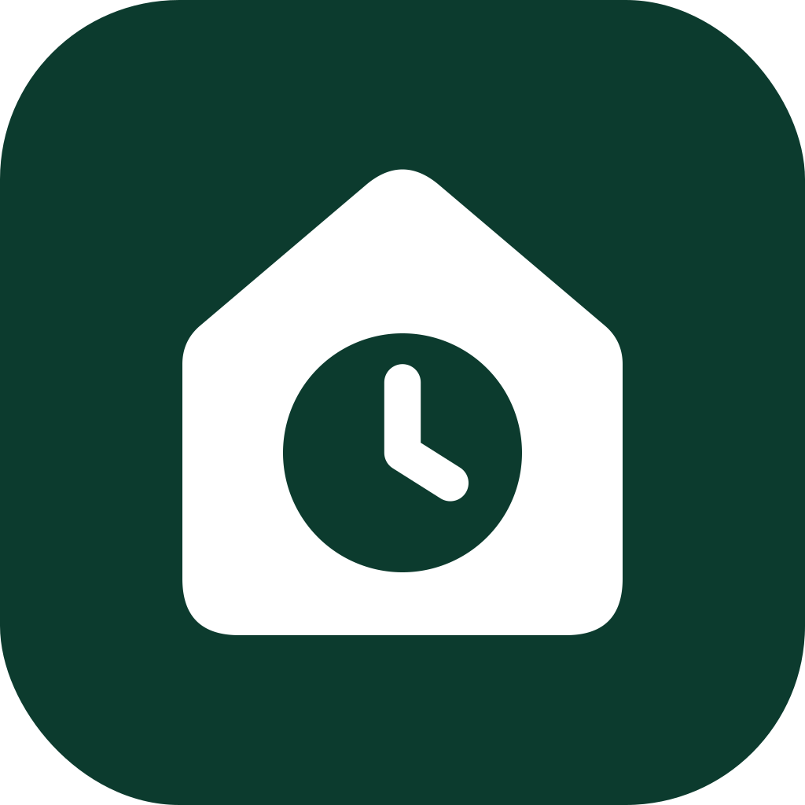
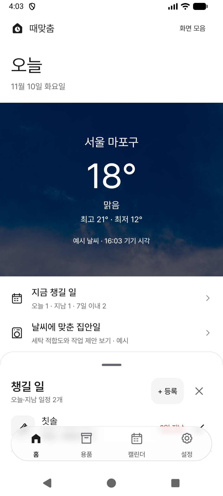
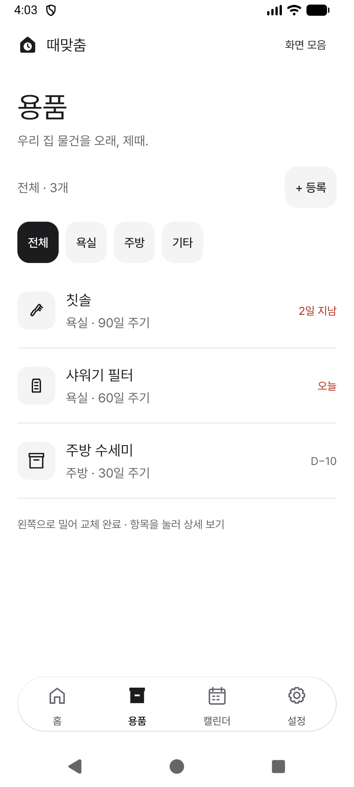
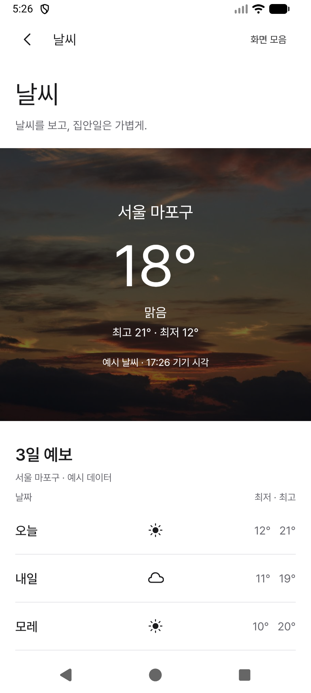
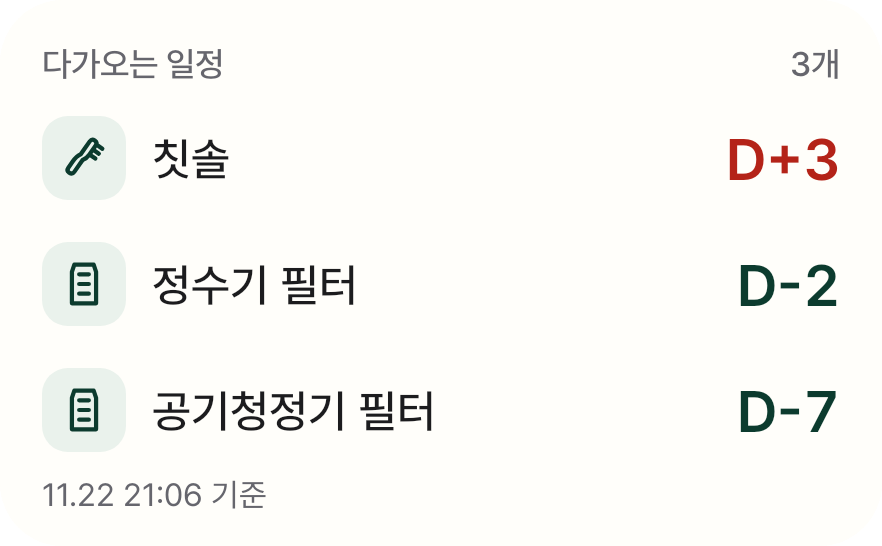
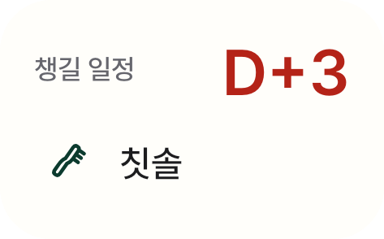

<div align="center">
  
  <h1>때맞춤 · Home Timing</h1>
  <p><strong>교체할 때도, 집안일 할 때도. 우리 집을 때맞춰.</strong></p>
  <p>생활용품 교체일과 날씨에 맞춘 집안일을 가족과 함께 관리하는 Android 앱</p>
  <p><strong>Android 8.0+</strong> · Java + XML · Firebase · 기상청 예보</p>
  <p>
    <a href="https://github.com/kw-mobile/home-timing/releases/latest">APK 다운로드</a> ·
    <a href="#화면-둘러보기">화면 둘러보기</a> ·
    <a href="docs/README.md">문서 안내</a> ·
    <a href="docs/SETUP.md">개발 환경 설정</a>
  </p>
</div>

---

## 실행 영상과 APK 설치

[실제 연동 실행 영상 다운로드](https://github.com/kw-mobile/home-timing/releases/download/v0.5.2/home-timing-demo-live-v0.5.2.mp4) · [시연 방식과 한계](docs/media/presentation/README.md)

아래 QR을 휴대폰으로 스캔하면 **v0.5.2 APK**를 직접 내려받습니다.


## 어떤 앱인가요?

칫솔을 언제 바꿨는지, 이번 주 세탁은 언제 하면 좋을지, 가족 중 누가 집안일을 마쳤는지 한곳에서 확인합니다. 생활용품은 시작일과 교체 주기로, 집안일은 반복 요일과 날씨로 관리합니다.

| 일상에서 필요한 것 | 때맞춤에서 하는 일 |
| --- | --- |
| 교체일 기억하기 | 생활용품의 교체 예정일·D-day를 확인하고 완료 이력을 남깁니다. |
| 집안일 나누기 | 집에 초대된 가족과 용품·집안일·분류·완료 이력을 공유합니다. |
| 날씨에 맞춰 계획하기 | 집 지역의 기상청 예보로 세탁 적합도와 집안일 날짜 제안을 확인합니다. |
| 앱 밖에서도 챙기기 | 개인별 로컬 알림과 홈 화면 위젯으로 예정된 일을 확인합니다. |
| 등록을 간편하게 | 자주 쓰는 품목 버튼과 선택형 사진 인식으로 용품 이름 입력을 돕습니다. |

## 화면 둘러보기

아래는 **디자인 갤러리의 예시 데이터로 촬영한 화면**입니다. 현재 앱은 이후 분류 편집·홈 여백·버튼 배치 등이 개선되어 일부 차이가 있습니다. 캡처별 앱 SHA와 상태는 [화면 명세](docs/report/evidence/component-system/manifest.json)에서 확인할 수 있습니다.

<table>
  <tr>
    <th width="33%">홈</th><th width="33%">생활용품</th><th width="33%">날씨</th>
  </tr>
  <tr>
    <td></td>
    <td></td>
    <td></td>
  </tr>
  <tr>
    <td>오늘의 날씨와 챙길 일을 한눈에</td><td>분류별 용품과 교체일 확인</td><td>날씨를 보고 집안일 계획</td>
  </tr>
</table>

[라이트 전체 화면](docs/design-jpg/overview-light.jpg) · [다크 전체 화면](docs/design-jpg/overview-dark.jpg) · [전체 JPG 보드](docs/design-jpg) · [오프라인 HTML 갤러리](docs/design-review.html)

HTML 갤러리는 파일을 내려받아 브라우저에서 열면 인터넷 없이 확인할 수 있습니다. 화면별 입력·상태·컴포넌트 규격은 [디자인 시스템](docs/DESIGN_SYSTEM.md)을 참고하세요.

### 홈 화면 위젯

항목 아이콘과 함께 **D+N · D-day · D-N**을 표시합니다. 기한 지난 일정부터 다가오는 7일까지 순서대로 보여주고, 작게 줄이면 첫 일정 카드로 바뀝니다. 일정을 누르면 앱 상세로 연결됩니다.

<p align="center">
  
  
</p>

위젯 이미지는 [PR #109](https://github.com/kw-mobile/home-timing/pull/109)의 테스트 일정·크기 시나리오입니다. 표시 범위와 갱신 방식은 [위젯 계약](docs/MVP.md#홈-화면-위젯-106)을 따릅니다.

## 화면 구성

| 화면 | 주요 역할 |
| --- | --- |
| 로그인·가입 | 이메일 계정, 비밀번호 재설정, 저장된 계정 복구 |
| 홈 | 날씨 요약, 예정·기한 지난 일정, 집안일 제안 |
| 용품 목록 | 분류별 탐색, D-day, 등록·상세 진입 |
| 등록·수정 | 용품 주기 또는 집안일 반복 요일, 분류, 선택 정보 입력 |
| 상세·이력 | 완료 처리, 실제 완료일·완료자 확인, 수정·삭제 |
| 날씨 | 집 지역 예보, 세탁 적합도, 제안 확인 |
| 설정·가족 | 집 초대·참여, 공유 지역, 개인 알림, 앱 업데이트 |

캘린더 화면 시안과 휴대폰 캘린더 연동의 제공 범위는 [MVP](docs/MVP.md)를 확인하세요. 화면 시안과 실제 서비스 검증 결과는 별도로 관리합니다.

## 기술 구성

| 영역 | 사용 기술 | 맡는 역할 |
| --- | --- | --- |
| Android UI | Java · XML · Material Components | 화면·다크 모드·공통 컴포넌트 |
| 화면 상태 | ViewModel · LiveData | 화면 상태 유지와 비동기 결과 표시 |
| 계정·공유 데이터 | Firebase Authentication · Cloud Firestore | 이메일 인증, 집 단위 공유, 트랜잭션·권한 규칙 |
| 날씨 통신 | Retrofit · OkHttp · 기상청 API허브 | 예보 조회·파싱·캐시와 오류 구분 |
| 사진 입력 | CameraX · LiteRT · ML Kit OCR | 기기 내 사물 후보·문자 인식, 이름 선택 보조 |
| 알림·위젯 | WorkManager · Android 알림 · RemoteViews | 일정 재동기화, 로컬 알림, 크기에 따른 위젯 표시 |
| 품질·배포 | JUnit · Android Lint · Firebase Emulator · GitHub Actions | 규칙·권한 테스트, 빌드, 서명 APK 릴리스 |

사진 입력은 정확한 제품 모델이나 교체 주기를 자동 확정하지 않습니다. 적용할 이름은 사용자가 선택합니다. 라이브러리 버전은 [버전 카탈로그](gradle/libs.versions.toml)에서 관리합니다.

```text
화면 (Java + XML)
  └─ ViewModel ── Repository ── Firebase / 기상청 / 기기 저장소
          └──────── domain ───────┘
                    날짜·주기·회차·날씨 판정
```

UI는 입력·표시, ViewModel은 화면 상태, Repository는 외부 데이터, domain은 순수 Java 규칙을 담당합니다. 세부 구조는 [아키텍처](docs/ARCHITECTURE.md), 공유 데이터와 권한은 [데이터 모델](docs/DATA_MODEL.md)을 참고하세요.

## 시작하기

**앱을 사용하려면** [정식 릴리스](https://github.com/kw-mobile/home-timing/releases/latest)에서 APK를 내려받습니다. 설치 후 업데이트 방식은 [앱 내 업데이트](docs/SETUP.md#앱-내-업데이트용-배포-정보)를 참고하세요.

**개발에 참여하려면** [환경 설정](docs/SETUP.md)에 따라 JDK 17과 Android SDK를 준비하고 Android Studio에서 저장소 루트를 엽니다.

```sh
./gradlew teamDoctor
./gradlew :app:assembleDebug :app:testDebugUnitTest :app:lintDebug
```

Windows에서는 `./gradlew.bat`를 사용합니다. Firebase 설정과 기상청 키 없이도 기본 빌드가 가능하며, 실제 로그인·공유·예보 연결은 [외부 서비스 설정](docs/SETUP.md#외부-서비스)을 따릅니다. 일반 실행은 로그인 또는 저장된 계정의 집을 열고, 설정이 없으면 연결 안내를 표시합니다. 예시 화면은 debug APK의 [명시적 미리보기 실행](docs/DESIGN_SYSTEM.md#미리보기-실행)으로 확인합니다.

Codex나 Claude Code에는 **“이 프로젝트 개발 환경 설정해줘”**라고 요청할 수 있습니다. [team-setup](.agents/skills/team-setup/SKILL.md)이 도구 확인·개인 Firebase 연결·기본 빌드를 안내하며 계정 인증과 기상청 키는 본인이 준비합니다. 명시 호출은 Codex `$team-setup`, Claude Code `/team-setup`입니다.

## 문서와 기여

| 찾는 내용 | 바로가기 |
| --- | --- |
| 처음 보는 사람을 위한 길잡이 | [문서 안내](docs/README.md) |
| 제품 범위와 동작 규칙 | [MVP](docs/MVP.md) |
| 화면·브랜드·컴포넌트 | [디자인 시스템](docs/DESIGN_SYSTEM.md) |
| 개발·데이터 구조 | [아키텍처](docs/ARCHITECTURE.md) · [데이터 모델](docs/DATA_MODEL.md) |
| 실행·테스트·배포 | [환경 설정](docs/SETUP.md) · [검증 기준](docs/TESTING.md) |
| 작업 참여·기록 | [협업 규칙](CONTRIBUTING.md) · [기여 기록 기준](docs/report/README.md) · [개발 기록](docs/report/WORKLOG.md) |
| AI 도구 작업 지침 | [AGENTS.md](AGENTS.md) · [스킬 안내](docs/SKILLS.md) · [CLAUDE.md](CLAUDE.md) |

구현·빌드 성공과 실기기·실서비스 검증은 구분해 기록합니다. 현재 기능의 확인 근거는 관련 PR과 [검증 기준](docs/TESTING.md)에서 확인하세요. [기존 Notion 기획](https://app.notion.com/p/40f8bac3963f80298786d02fdf27da79)과 범위가 다르면 MVP 문서를 기준으로 합니다.
