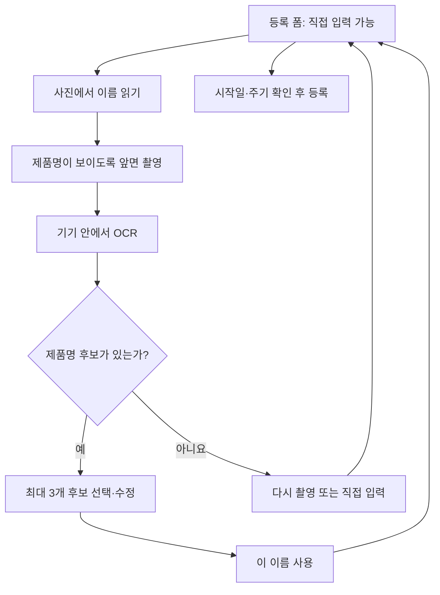

# 제출 MVP 실행 기준

## 목적과 기준

생활용품 교체를 잊지 않게 하고, 세탁일을 날씨에 맞춰 조정합니다. 교체 예정일은 날짜·주기로만 계산하며 날씨는 집안일에만 적용합니다. 앱 이름은 때맞춤, Android applicationId와 namespace는 `com.kwmobile.hometiming`입니다.

기존 [PRD](https://app.notion.com/p/4108bac3963f80f894a7eff15ebc9d21)·[TRD](https://app.notion.com/p/4108bac3963f8073bcbfe3c284792e38)의 상세 규칙을 바탕으로, 아래 조정을 적용합니다. 충돌 시 이 문서가 제출 구현 기준입니다. 작성 시점의 계획이며 구현 완료를 뜻하지 않습니다. 환경 변경은 [SETUP](SETUP.md), 구조는 [아키텍처](ARCHITECTURE.md), 작업 진행은 GitHub 이슈에서 관리합니다. 실제 참여 내역과 보고서 근거는 [기여 기록 기준](report/README.md)을 따릅니다.

## 범위 결정

| 영역 | P0 제출 범위 | 제외·P1 |
| --- | --- | --- |
| 계정 | 이메일 가입·로그인·자동 로그인·로그아웃·비밀번호 재설정 | 소셜 로그인 |
| 용품 | 등록·수정·삭제·교체일·D-day·완료·완료자 이력 | 사진 |
| 집 | 자동 1인 집, 초대, 참여, 나가기, 집장 내보내기, 최대 6명, 공동 관리 | 기존 항목·이력의 집 간 이전, 집장 양도 |
| 집안일 | 매주 요일 반복, 완료 이력, 이번 회차 날짜 변경 | N일 간격 반복 |
| 날씨 | 집 지역, 기상청 예보, 세탁 판정·날짜 제안, 테스트 날씨 모드 | GPS, 대기질 API |
| 알림 | 개인 시각·사전 일수, 용품·집안일 로컬 알림, 재부팅 후 재예약 | 서버 푸시, 타 기기 완료의 즉시 수신 보장 |
| 화면 | 로그인, 홈, 용품 목록, 등록·수정, 상세·이력, 날씨, 설정·가족 관리 | 월간 캘린더 탭·화면 |

용품 등록의 필수 사용자 입력은 이름·시작일·주기 3개입니다. 분류는 기본 `기타`가 선택되어 저장되며 변경할 수 있습니다. 프리셋은 편의값이며 제품 설명서 권장 주기를 따르도록 안내합니다. 등록일·실제 완료일은 미래를 허용하지 않고, 주기는 1~730일입니다. 날짜는 Asia/Seoul 기준으로 계산합니다.

분류 선택 창의 ‘+ 직접 입력’과 용품 목록의 분류 칩 뒤 + 버튼으로 사용자 분류를 추가할 수 있습니다. 분류명은 앞뒤 공백을 제거한 1~30자이며 중복 이름과 필터명 ‘전체’는 허용하지 않습니다. 기본 분류를 유지하면서 등록 항목의 분류와 직접 추가한 분류를 중복 없이 칩에 표시합니다. 생활용품·집안일의 분류는 각각 관리합니다. 목록과 분류 선택 창의 ‘분류 관리’에서 사용자 분류를 선택해 확인 후 삭제합니다. 기본 분류는 유지하며 항목·작성 중인 초안에서 사용 중이면 다른 분류로 변경하도록 안내하고 삭제를 차단합니다. 삭제한 분류가 목록 필터였다면 ‘전체’로 돌아갑니다. 현재 미리보기의 분류·항목은 화면 재생성에 복원되는 로컬 예시 상태이며 서버 저장·가족 공유와는 연결되지 않았습니다.

실제 제품 기능의 P0 우선순위는 캘린더를 제외한 7개 논리 화면입니다. **2026-11-10 사용자 확인: 과제는 5개 이상 화면이며 Activity 개수 제한은 없습니다.** 디자인 미리보기는 제공된 PRD 화면 명세 전체인 S1~S8과 홈·용품·캘린더·설정 4개 탭으로 구성합니다. 캘린더의 디자인은 포함하되 실제 저장·공유 기능의 P1 우선순위를 바꾸거나 완료로 간주하지 않습니다. 디자인·실행 방법은 [디자인 시스템](DESIGN_SYSTEM.md)을 따릅니다. 등록·상세 화면은 용품과 집안일이 공용으로 사용하되 집안일은 요일·날씨 민감 여부를 표시합니다. 홈에서 두 종류의 일정을 관리하고, 항목 종류와 ID로 상세를 엽니다.

## 사진·바코드 등록 탐색 계획 (P1, 미구현)

**현재 결정: 사진 OCR을 우선합니다.** 제품 앞면의 이름이 보이도록 촬영하면 기기 안에서 한글·영문을 읽고 이름 후보를 제안합니다. 사용자가 선택·수정한 이름을 등록 폼에 적용하며, 인식이 어렵다면 직접 입력으로 끝낼 수 있어야 합니다. 사진 속 제품의 외형만으로 정확한 모델·SKU를 식별하는 기능은 포함하지 않습니다.

테스트부터 인식 비용은 0원이어야 합니다. CameraX + bundled ML Kit를 사용하고 유료 API·외부 상품 DB·클라우드 OCR·LLM·체험 크레딧으로 보완하지 않습니다. 무료 실기기 검증 기준을 충족하지 못하면 사진 인식 경로를 폐기하고 수동 등록을 유지합니다.

현재 앱 진입 화면은 Android XML 디자인 미리보기이며 카메라·OCR은 미구현입니다. main에 구현된 P0 Repository의 실제 등록·저장은 미리보기 UI에 아직 연결하지 않았습니다. 무료 인식 실험을 먼저 하고, 통과한 뒤 P0 등록 기능에 연결합니다. 별도 큰 글씨 시안은 만들지 않습니다.

### 1. 바코드 조회 시험 결과와 범위 변경

사용자가 [로컬 I2570 도구](../scripts/foodsafety/README.md)로 `4902430597241`을 실행한 결과를 전달했습니다: 종료 코드 3, `INFO-200`(해당 데이터 없음). 이것은 해당 API에서 이 번호를 찾지 못했다는 관찰이며 바코드 자체의 오류나 모든 제품의 조회 실패를 증명하지 않습니다. 키 값은 기록하지 않습니다.

[국내 코리안넷 API](https://api.koreannet.or.kr/front/koreannet/dbApply.do)는 유료 계약 조건이고, [식약처 I2570](https://www.data.go.kr/data/15064775/openapi.do?recommendDataYn=Y)은 무료지만 공공데이터포털에 2018년 이후 최신화 중단이 기재되어 있습니다. 현재 생활용품의 제품명을 얻는 핵심 경로로 채택하지 않습니다. 바코드 촬영·상품 DB 조회·기기 내 바코드 이름 기억도 1차 구현에서 제외합니다. 기존 CLI는 조사 도구로 남기며 앱에 연결하지 않습니다.

### 2. 무료 기술 선택

2026-11-09 [ML Kit 무료 안내](https://developers.google.com/ml-kit/guides)와 [Android 한글·라틴 OCR](https://developers.google.com/ml-kit/vision/text-recognition/v2/android)의 bundled 구성을 확인했습니다. 구현 시작 때 조건을 다시 확인하고 SDK 버전을 저장소 카탈로그·잠금 파일에 고정합니다. 현재 의존성을 추가하거나 도구 버전을 올리지는 않습니다.

| 항목 | 1차 구현 범위 |
| --- | --- |
| 촬영 | [CameraX](https://developer.android.com/media/camera/camerax/architecture), Java + XML, 전체 화면 카메라 |
| 인식 | bundled 한글·라틴 OCR로 사진 한 장의 글자 읽기 |
| 제안 | 포장 글자에서 제품명 후보 최대 3개, 원문을 사용자가 수정 가능 |
| 등록 | 확인한 이름만 P0 등록 폼에 적용. 시작일·교체 주기는 사용자 입력 |
| 제외 | 제품 외형만으로 모델 식별, 교체 주기 추정, 사진 보관함·서버 업로드, 바코드·상품 DB 조회 |

모델을 APK에 포함해 첫 인식에 모델 다운로드가 필수가 되지 않게 합니다. APK 크기·처리 시간은 실측합니다. [ML Kit의 처리·통신 설명](https://developers.google.com/ml-kit/terms)에 따라 사진·인식 결과는 기기 안에서 처리하되 SDK의 업데이트·성능 지표 통신 가능성은 별개입니다. 사진을 서버로 보내지 않는다는 것을 앱의 모든 통신이 없다는 의미로 표현하지 않습니다.

### 3. 촬영·확인·수동 입력 흐름

등록 화면은 **제품명 / 시작일 / 교체 주기**가 있는 일반 페이지입니다. 제품명 옆에 ‘사진에서 이름 읽기’를 두고 직접 입력도 처음부터 제공합니다. 홈 교체 패널 외에 등록·촬영·결과 화면을 드래그 모달로 만들지 않습니다.

카메라는 글자가 들어올 사각 가이드를 보여주고 셔터를 눌러 한 장만 처리합니다. 촬영 안내는 ‘포장 앞면의 제품명이 보이게 찍어주세요’로 구체화합니다. 작은 글자·반사·흔들림에 대해 재촬영을 제안하되 강제하지 않습니다. 후보를 누르는 것과 ‘이 이름 사용’으로 폼에 적용하는 행동을 구분합니다. 기존 이름이 있다면 적용 전 기존값·제안값을 보여주고, 시작일·주기는 바꾸지 않습니다.

| 상태 | 표시와 실제 행동 |
| --- | --- |
| 대기 | 직접 입력·사진에서 이름 읽기 |
| 권한 거부·카메라 불가 | ‘직접 입력’으로 폼 복귀. 카메라 허용을 등록의 필수 조건으로 만들지 않음 |
| 인식 중 | 진행 표시와 취소·직접 입력. 동시 분석 한 건만 허용 |
| 후보 있음 | 최대 3개 이름과 편집 입력·이 이름 사용·다시 촬영 |
| 글자 없음·모델 오류 | ‘이름을 읽지 못했어요.’ 다시 촬영·직접 입력 |
| 분석 시작 후 8초 초과 | 작업 취소 상태로 전환, 뒤늦은 결과 무시, 재시도·직접 입력 |
| Back·취소·앱 중지 | 초안 유지, 카메라·분석 정리. 앱 복귀 뒤 사용자 입력 없이 카메라를 재가동하지 않음 |
| 회전·화면 재생성 | 이름·날짜·주기 초안과 선택 결과 유지. 큰 이미지는 저장 상태에 넣지 않음 |
| 오프라인 | 인식·폼 편집 가능. 최종 저장은 기존 P0 온라인 계약대로 제한하고 초안 유지 |

탭 영역은 최소 48dp로 하고, 처리 중에도 직접 입력·취소에 접근할 수 있게 합니다. 이미지가 인식되지 않아도 등록 폼까지 한 번의 ‘직접 입력’ 선택으로 돌아가야 합니다. OCR 점수를 정확한 제품 정체의 확률처럼 표시하지 않습니다. 분류 기본값 `기타`와 날짜·주기는 이 문서의 P0 계약을 따릅니다.

### 4. 후보·초안·사진 처리 계약

**후보 추출:** 한글·라틴 결과의 줄과 위치 정보를 받아 공백을 정리하고 중복 줄을 합칩니다. 숫자·단위만 있는 줄, 주소·전화번호·고객센터·성분 설명은 우선순위를 낮추고 가이드 중심·글자 크기·짧은 이름 줄을 우선합니다. 알려지지 않은 단어를 임의 브랜드명으로 바꾸지 않습니다. 정확한 규칙·길이 제한은 S1의 개발용 제품에서 조정한 뒤 검증 전에 고정합니다.

**초안과 작업 구분:** 분석 요청은 `draftId + accountId + houseId + requestId`에 연결합니다. 다른 사진 촬영·취소·새 초안·로그아웃·집 전환/탈퇴 시 이전 결과를 무효화합니다. 늦은 OCR 결과가 다른 제품의 이름을 덮어쓰거나 사용자가 수정한 값을 바꾸지 않게 합니다. 같은 초안의 회전·일시 중단에는 입력과 선택 결과를 보존합니다. ‘이 이름 사용’ 전에는 등록 폼의 이름을 바꾸지 않습니다.

**저장:** 최종 등록 때 이름·시작일·주기와 대상 계정·집을 불변 스냅샷으로 고정합니다. 인식 성공·후보 선택만으로 저장하지 않습니다. 원격 저장 성공/실패와 중복 제출 차단은 기존 P0 계약을 따릅니다. 서버에 사진·OCR 전문·인식 신뢰도 필드를 추가하지 않습니다.

**임시 사진:** 앱 내부 임시 영역에서 처리하고 후보 추출 완료·취소·시간 초과 후 정리합니다. 프로세스 종료로 남은 임시 파일은 다음 실행 때 정리합니다. 원본 사진·OCR 전문을 Firestore·공유 저장소·로그로 보내지 않습니다. 프로세스 종료 후 큰 사진을 복원하려 하지 않고 초안으로 돌아가 재촬영을 제안합니다.

기술 배치는 [아키텍처의 인식 연결 계획](ARCHITECTURE.md#사진바코드-등록-연결-계획-미구현)을 따릅니다. 지금 빈 패키지·클래스를 만들지 않습니다.

### 5. 실행 순서와 완료물

담당자는 미정입니다. S0–S5는 단계명이며 GitHub 이슈 번호가 아닙니다. 구현 시 완료 기준을 이슈에 옮기고 실제 담당자를 배정합니다. 기기·표본이 확보되기 전 날짜·공수를 확약하지 않습니다.

| 단계 | 선행 | 완료물 | 다음 단계 기준 |
| --- | --- | --- | --- |
| S0 무료 조건 확인 | 없음 | bundled 구성·비용·지원 기기 확인, 실제 포장 표본 확보 | 인식용 키·결제·유료 서버 없이 시험 가능 |
| S1 사진 인식 실험 | S0 | 별도 debug 화면의 촬영→한글/영문 인식→최대 3개 이름 후보. 개발용 10개로 후보 규칙 조정 후 동결 | 아래 G1·G2 평가, 실패하면 OCR 경로 중단 |
| S2 수동 등록 완성 | P0 계정·집·Repository | 직접 입력·검증·초안 유지·온라인 등록 성공/실패 | 사진 없이도 실제 등록 가능 |
| S3 후보 확인 화면 | S1 통과 | 이름 선택·수정·이 이름 사용·취소·다시 촬영 | 상태·권한·시간 초과·수동 복귀 검증 |
| S4 등록 폼 연결 | S2 + S3 | 검증된 이름 후보를 기존 폼에 연결, 대상 집·초안·작업 구분 | 늦은 결과·중복 제출·집 전환·저장 실패 검증 |
| S5 최종 판정 | S4 | 보유 실기기 검증, 앱 SHA·SDK/모델·성공/실패·시간 기록 | G1–G3 통과, 미통과이면 OCR 제거·수동 등록 유지 |

S1은 P0 저장을 만들기 전에도 실험할 수 있지만 Firebase·제품 저장과 분리합니다. 실험 코드가 main에 자동 반영되거나 제품 UI에 자동 노출되지는 않습니다. S3/S4에서 후보 규칙을 바꾸면 새 검증 표본으로 G2를 다시 평가합니다.

### 6. 검증·채택·폐기 기준

개발용 제품 10개와 SKU가 겹치지 않는 검증 제품 20개를 확보합니다. 칫솔·필터·기타 실제 교체용품을 포함하고 인식이 쉬운 제품만 고르지 않습니다. 출력 보기 전에 팀원이 실물 포장에서 허용 이름을 기록하고 다른 사람이 채점합니다. 정답·후보 규칙·분모는 검증 전에 고정합니다. 재촬영 결과는 첫 시도와 분리하고 같은 SKU를 여러 개의 독립 성공으로 세지 않습니다. 검증 세트로 규칙을 고치면 그 세트는 개발용으로 돌리고 새로운 SKU로 평가합니다.

| Gate | 실험 전 정할 기준 | 미달 시 |
| --- | --- | --- |
| G1 무료·오프라인 | bundled APK 신규 설치 후 첫 인식 전에 비행기 모드. 외부 인식 API·결제수단·체험 크레딧 없이 동작, 인식 비용 0원 | 유료 보완 없이 사진 인식 폐기 |
| G2 이름 후보 | 명료한 포장 20개 중 첫 사진의 상위 3개에 허용 이름 16개 이상. NFC·공백 정리 후 완전 일치이며 부분 문자열·사용자 수정은 제외 | OCR을 제품 UI에 연결하지 않음 |
| G2 처리 시간 | 사진 획득부터 후보 표시까지 3초 이내가 20개 중 19개 이상 | 사진 인식 경로 채택 보류, 유료 서비스로 보완하지 않음 |
| G3 실패 복구 | 권한 거부·글자 없음·카메라 불가·시간 초과·취소 각각 ‘직접 입력’ 한 번으로 복귀, 기존 이름·날짜·주기 보존 | 수정 전 채택 불가 |
| G3 저장·수명 | 취소·이전 작업의 결과가 이름 적용·등록을 만들지 않음. 회전·백그라운드·집 전환·저장 실패·중복 제출에 P0 계약 유지 | 수정 전 채택 불가 |

수치는 제안한 제품 채택 기준이며 성능 보증이나 달성 결과가 아닙니다. 실험 전에는 조정할 수 있지만 결과를 보고 통과시키려고 낮추지 않습니다. 가능한 서로 다른 OS의 팀 보유 실기기 두 대에서 확인하고, 한 대만 가능하면 해당 기기 결과와 나머지 미검증을 명시합니다. 에뮬레이터로 실물 포장 인식률을 증명하지 않습니다.

반사·흐림·회전·아주 작은 글자·글자 없는 제품은 별도 어려운 표본으로 보고하고 실패를 숨기지 않습니다. 앱 SHA·SDK/모델 버전·기기/OS·표본/SKU·정답 작성자·채점자·첫 시도·재촬영·처리 시간·비용 근거를 남깁니다.

**완료 조건:** 촬영→이름 후보 확인·수정→등록 폼→사용자 확인→실제 저장이 이어지고 실패하면 입력을 잃지 않고 수동으로 끝낼 수 있어야 합니다. 현재 OCR 실기기 Gate는 실행하지 않았습니다. 다음 작업은 S0/S1의 무료 사진 OCR 실험이며 사진 인식 성공을 아직 주장하지 않습니다.

## 요구사항 식별자

기능 이슈·PR·검증·보고서를 연결할 때 기존 PRD의 ID를 유지합니다. ID가 같아도 이번 제출 범위는 위의 조정을 적용합니다.

| ID | 이번 제출에서 확인할 기능 |
| --- | --- |
| F-01 | 계정·로그인 |
| F-02~F-05 | 용품 등록·수정·삭제·교체일·완료 이력 |
| F-06 | 로컬 알림 |
| F-07 | 주간 집안일 |
| F-08 | 지역·실제 날씨 조회 |
| F-09 | 날씨 기반 일정 제안 |
| F-10 | 홈 대시보드 |
| F-13 | 테스트 날씨 모드 |
| F-14 | 가족 공동 관리 |

F-11 캘린더·F-12 사진은 P1이며 제출 구현으로 자동 간주하지 않습니다. 환경·문서 작업에는 제품 기능 ID를 억지로 배정하지 않고 관련 이슈로 연결합니다.

## 데이터·권한 계약

- 항목과 이력은 집에 속합니다. 현재 집의 구성원만 읽고 등록·수정·완료할 수 있습니다.
- 삭제는 등록자·집장, 지역 변경·초대 발급·내보내기는 집장만 가능합니다. UI와 Firestore 규칙 모두에서 제한합니다.
- 집 참여는 항목과 이력이 없는 1인 집에서만 허용합니다. 기존 데이터의 자동 복사·삭제를 통한 이전은 구현하지 않습니다. 이미 여러 명인 집은 먼저 나가 새 1인 집을 만든 뒤 참여합니다.
- 구성원은 나가면 빈 1인 집을 받습니다. 집장은 다른 구성원이 남아 있으면 나갈 수 없습니다. 내보내진 사용자는 다음 온라인 접속에서 현재 소속을 복구하고 빈 1인 집을 받습니다.
- 초대는 6자리·24시간이며 재발급 시 이전 코드를 무효화합니다. 유효 기간 안에는 한 코드로 여러 명(최대 6명)이 참여할 수 있고, 참여자의 원래 빈 1인 집은 참여와 함께 삭제합니다([설계](DATA_MODEL.md#가족-공유-초대참여나가기내보내기)). 참여 시 인원 제한과 사용자·집 소속 변경을 서버가 검증할 수 있도록 원자적으로 처리합니다. 비구성원의 집 읽기를 허용하는 방식으로 해결하지 않습니다. 구체적인 참여 문서·규칙 설계와 거부 테스트를 가족 기능 구현 전에 확정합니다.
- 재귀 와일드카드로 집 전체 쓰기를 포괄 허용하지 않습니다. 집·항목·이력별 허용 필드와 소유권을 검증하고, 소속·집장·생성자 필드의 임의 변경을 거부합니다.
- 부모 문서 삭제로 하위 문서가 자동 삭제된다고 가정하지 않습니다. 항목·빈 집 정리와 회원 탈퇴에는 하위 이력·초대 정리 및 실패 재시도 정책을 포함합니다. Auth 계정 삭제는 데이터 정리를 마친 뒤 수행하며, 다른 기기의 재생성을 막는 최소 삭제 상태는 데이터 모델의 정리 정책에 따라 유지합니다. 탈퇴하는 구성원이 등록한 항목·이력은 집에 남고, 다른 구성원이 있는 집의 집장은 먼저 구성원을 내보내야 탈퇴할 수 있습니다([정리 정책](DATA_MODEL.md#정리-정책)).

## 완료·반복 계약

- 완료·등록·수정·삭제·집 참여/나가기는 온라인에서만 확정합니다. 오프라인에서는 저장된 목록·상세를 읽고 변경 버튼을 비활성화합니다. 온라인 여부 사전 확인만 믿지 말고 실제 서버 작업의 실패도 처리합니다.
- 완료는 트랜잭션으로 현재 회차를 검증하고 이력 추가·다음 회차 갱신을 함께 커밋합니다. 완료 성공은 서버 커밋 뒤 표시합니다.
- 완료 회차는 예정일과 독립된 `occurrenceId`로 식별합니다. 일정·주기 등 화면 상태의 동시 변경은 `revision`으로 구분합니다. 같은 회차 중복 완료와 일정 수정 충돌을 서로 다른 안내로 처리합니다. 예정일 비교만으로 완료 여부를 판단하지 않습니다.
- 용품의 다음 예정일은 실제 교체일 + 주기입니다. 교체 완료마다 새 회차가 시작됩니다.
- 실제 교체일은 `이전 교체일 ≤ 실제 교체일 ≤ 오늘(Asia/Seoul)`이어야 합니다. 같은 날은 허용하고 더 이른 날은 거부합니다([#20 결정](https://github.com/kw-mobile/home-timing/issues/20#issuecomment-6765024251)). 입력 검증·완료 트랜잭션·보안 규칙이 모두 확인합니다. 잘못 등록한 날짜는 수정으로 고칩니다.
- 주간 집안일의 `plannedDueDate`는 원래 회차 날짜, `nextDueDate`는 이번 실행일입니다. 날씨에 따라 실행일을 옮겨도 회차 ID와 원래 날짜는 유지합니다. 완료하면 원래 회차 다음 주부터 **완료일보다 뒤인 첫 원래 요일**을 찾아 새 회차로 만듭니다. 밀린 주를 한꺼번에 생성하지 않습니다.
- 예: 토요일 11/7을 일요일 11/8로 옮겨 완료하면 다음은 토요일 11/14입니다. 11/20에 늦게 완료하면 다음은 11/21입니다.
- 취소·그대로 두기는 회차 ID 기준으로 관리합니다. 새 회차에서는 제안을 다시 평가합니다. 날짜 변경도 revision을 확인해 오래된 제안이 최신 일정을 덮어쓰지 않게 합니다.

## 날씨·알림 계약

- 09~18시 예보로 세탁을 판정하며 기존 PRD의 강수확률·강수형태·습도 기준을 사용합니다. 날씨는 용품 교체일을 바꾸지 않습니다.
- 응답 전체 건수와 날짜·시간·필수 항목을 확인합니다. 필요한 시간대가 누락되면 적합으로 추정하지 않고 판정 불가로 둡니다. 오늘 이미 지난 시각을 제안하지 않습니다.
- 알림은 기기의 마지막 동기화 상태를 기준으로 예약합니다. 앱 실행 중 완료·변경 수신 시 남은 예약과 표시된 해당 회차 알림을 취소합니다.
- 알림 직전 제한된 시간 안에 최신 서버 상태 확인을 시도합니다. 확인에 실패하면 **저장된 일정으로 알림**을 보냅니다. 다른 기기에서 이미 완료했어도 동기화 전에는 오래된 알림이 발생할 수 있습니다.
- 백그라운드 동기화는 서버 읽기를 시도하고 성공 시 로컬 상태와 예약을 갱신합니다. 캐시를 다시 읽는 것만으로 원격 동기화가 됐다고 판단하지 않습니다.
- 개인 알림 설정 변경·로그아웃·집 변경 시 예약을 정리합니다. 항목 종류·집·회차·알림 종류를 포함한 식별자를 사용하고 같은 회차의 즉시 알림을 반복 발송하지 않습니다.
- 정확한 알람 권한이 없으면 부정확 알람을 사용하고 지연 가능성을 안내합니다. 정시·±15분·1분 뒤 도착을 무조건 보장하지 않습니다. 강제 종료 상태는 정상 종료·재부팅 검증과 구분합니다.

## 구현 순서와 완료 기준

1. **개인 교체 관리:** 로그인 → 1인 집 → 용품 등록 → 목록·D-day → 완료·이력. 날짜 경계와 완료 충돌 단위 테스트를 추가합니다.
2. **가족 공유와 규칙:** 두 기기 참여 → 공동 목록 → 완료자 이력. 비구성원 접근, 일반 구성원의 집장 작업·타인 삭제·필드 변조, 만료 코드·정원 초과·동시 완료를 검증합니다. Firebase Emulator Suite의 거부 테스트를 포함합니다.
3. **알림:** 사전·당일 예약, 권한 거부, 재부팅, 개인 설정·집 변경, 타 기기 완료 후 동기화에 따른 취소를 확인합니다. 온라인 확인 실패 시 캐시 정책도 검증합니다.
4. **집안일과 날씨:** 주간 일정 → 실제 예보 → 제안 수락·거절 → 다음 회차 → 테스트 날씨 모드. API 실패·누락 예보에도 용품 기능이 유지되는지 확인합니다.
5. **통합 시연:** 아래 두 시나리오를 두 기기에서 실행하고 기종·OS·앱 커밋·성공/실패를 이슈에 남깁니다. APK 빌드나 테스트 날씨만으로 실제 API·공유·알림 검증을 대신하지 않습니다.

시연 A: 필터 등록 → 가족 기기 목록 반영 → 한쪽 완료 → 양쪽 완료자 이력 반영 → 동기화된 기기의 남은 알림 취소.

시연 B: 비 예보 → 세탁일 변경 → 일요일 완료 → 다음 주 원래 토요일로 생성. 테스트 날씨 화면에는 테스트 데이터임을 표시하고 실제 API 검증 결과를 별도로 남깁니다.

제출 목표는 기존 기획의 11/23이며, 원래 개발 마감 11/19 이후는 통합 검증·보고서·시연 준비에 사용합니다. 실제 담당자와 작업 기한은 팀이 GitHub 이슈에 배정합니다.
