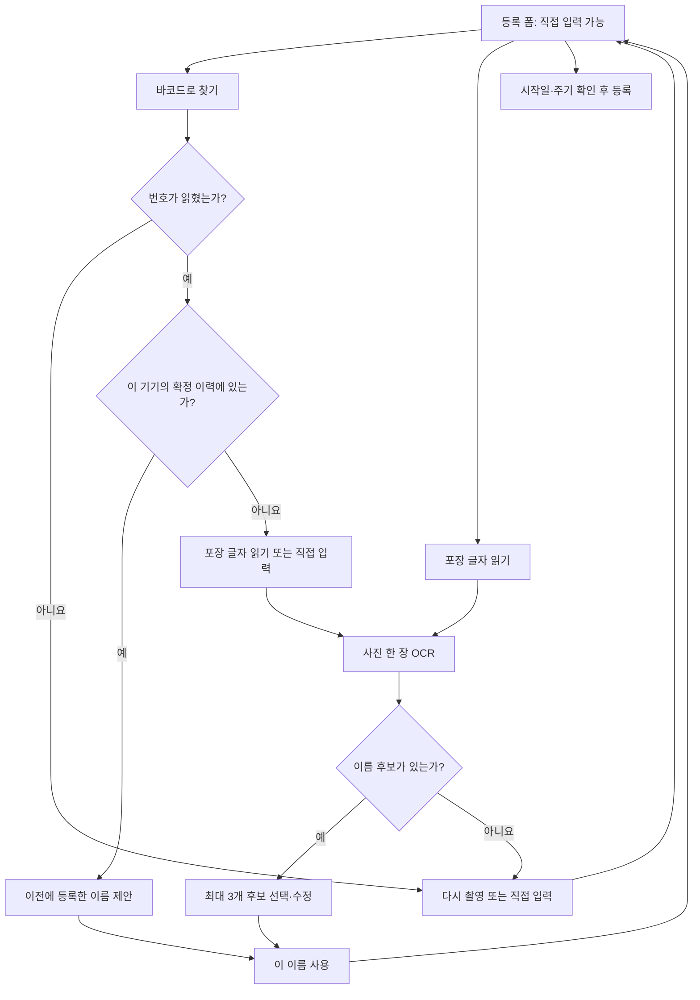

# 제출 MVP 실행 기준

## 목적과 기준

생활용품 교체를 잊지 않게 하고, 세탁일을 날씨에 맞춰 조정합니다. 교체 예정일은 날짜·주기로만 계산하며 날씨는 집안일에만 적용합니다. 앱 이름은 때맞춤, Android applicationId와 namespace는 `com.kwmobile.hometiming`입니다.

기존 [PRD](https://app.notion.com/p/4108bac3963f80f894a7eff15ebc9d21)·[TRD](https://app.notion.com/p/4108bac3963f8073bcbfe3c284792e38)의 상세 규칙을 바탕으로, 아래 조정을 적용합니다. 충돌 시 이 문서가 제출 구현 기준입니다. 작성 시점의 계획이며 구현 완료를 뜻하지 않습니다. 환경 변경은 [SETUP](SETUP.md), 구조는 [아키텍처](ARCHITECTURE.md), 작업 진행은 GitHub 이슈에서 관리합니다. 실제 참여 내역과 보고서 근거는 [기여 기록 기준](report/README.md)을 따릅니다.

## 범위 결정

| 영역 | P0 제출 범위 | 제외·P1 |
| --- | --- | --- |
| 계정 | 이메일 가입·로그인·자동 로그인·로그아웃·비밀번호 재설정 | 소셜 로그인 |
| 용품 | 등록·수정·삭제·교체일·D-day·완료·완료자 이력 | 사진 |
| 집 | 자동 1인 집, 초대, 참여, 나가기, 집장 내보내기, 최대 6명, 공동 관리 | 기존 항목·이력의 집 간 이전, 집장 양도 |
| 집안일 | 매주 요일 반복, 완료 이력, 이번 회차 날짜 변경 | N일 간격 반복 |
| 날씨 | 집 지역, 기상청 예보, 세탁 판정·날짜 제안, 테스트 날씨 모드 | GPS, 대기질 API |
| 알림 | 개인 시각·사전 일수, 용품·집안일 로컬 알림, 재부팅 후 재예약 | 서버 푸시, 타 기기 완료의 즉시 수신 보장 |
| 화면 | 로그인, 홈, 용품 목록, 등록·수정, 상세·이력, 날씨, 설정·가족 관리 | 월간 캘린더 탭·화면 |

용품 등록의 필수 사용자 입력은 이름·시작일·주기 3개입니다. 분류는 기본 `기타`가 선택되어 저장되며 변경할 수 있습니다. 프리셋은 편의값이며 제품 설명서 권장 주기를 따르도록 안내합니다. 등록일·실제 완료일은 미래를 허용하지 않고, 주기는 1~730일입니다. 날짜는 Asia/Seoul 기준으로 계산합니다.

P0는 7개 논리 화면과 하단 탭 3개(홈·용품·설정)로 구성합니다. 등록·상세 화면은 용품과 집안일이 공용으로 사용하되 집안일은 요일·날씨 민감 여부를 표시합니다. 홈에서 두 종류의 일정을 관리하고, 항목 종류와 ID로 상세를 엽니다.

## 사진·바코드 등록 탐색 계획 (P1, 미구현)

**결정:** CameraX + bundled ML Kit로 바코드와 포장 글자를 기기 안에서 읽고, 사용자가 이름을 확인한 뒤 일반 등록 폼에 적용합니다. 테스트부터 인식 비용은 0원이어야 합니다. 외부 상품 DB·클라우드 OCR·유료 LLM·체험 크레딧은 1차 구현에 사용하지 않습니다. 무료 방식으로 기준을 충족하지 못하는 인식 경로는 폐기하고 수동 등록을 유지합니다.

현재는 Android XML 디자인 미리보기만 있으며 카메라·인식·P0 실제 등록·저장은 미구현입니다. 아래는 실행 계획과 합격 기준이며 성능 달성 결과나 구현 완료를 뜻하지 않습니다. **무료성·인식 가능성 실험을 먼저 하고, 통과한 경로만 P0 등록 기능 이후 연결**합니다. 별도 큰 글씨 시안은 만들지 않습니다.

### 1. 무료 기술과 지원 범위

2026-11-09 공식 문서를 확인했습니다. [ML Kit는 무료 SDK](https://developers.google.com/ml-kit/guides)이며 [바코드 Android SDK](https://developers.google.com/ml-kit/vision/barcode-scanning/android)와 [한글·라틴 OCR](https://developers.google.com/ml-kit/vision/text-recognition/v2/android)은 bundled 모델을 제공합니다. 구현 시작 때 비용·지원 조건을 다시 확인하고 버전은 저장소 카탈로그와 잠금 파일에 고정합니다. 지금 의존성을 추가하거나 도구 버전을 올리지 않습니다.

| 항목 | 1차 선택 | 포함하지 않는 것 |
| --- | --- | --- |
| 촬영 | [CameraX](https://developer.android.com/media/camera/camerax/architecture), Java + XML, 전체 화면 카메라 | 사진 보관함·사진 관리·추가 모달 |
| 바코드 | bundled ML Kit, EAN-13·EAN-8·UPC-A | QR·UPC-E·기타 형식의 자동 상품 해석 |
| 포장 글자 | bundled 한글·라틴 OCR, 사진 한 장 처리 | 제품 외형만 보고 모델·SKU 식별 |
| 이름 조회 | 같은 계정·같은 집·같은 기기의 확정 등록 이력 | 모든 생활용품을 찾는 외부 상품 DB |
| 저장 | 확인한 이름을 P0 등록 폼에 적용 | 사진 업로드·교체 주기 추정·촬영 즉시 등록 |

bundled 모델을 선택해 설치 후 첫 인식에 모델 다운로드가 필수가 되지 않도록 합니다. APK 크기와 실행 성능은 실측합니다. [ML Kit의 처리·통신 설명](https://developers.google.com/ml-kit/terms)에 따라 사진·인식 결과는 기기 안에서 처리하되 SDK의 업데이트·성능 지표 통신 가능성을 구분합니다. ‘사진을 서버로 보내지 않음’을 ‘앱에 어떤 통신도 없음’으로 표현하지 않습니다.

**바코드 제품명 한계:** 처음 보는 번호는 이름을 모릅니다. 처음 등록할 때 사용자가 확정한 이름을 이 기기에서 기억하고 다음 스캔에 제안하는 방식입니다. 바코드 인식률을 새 제품의 이름 조회율로 발표하지 않습니다. 모든 제품의 최초 이름 조회는 이번 범위에서 미지원입니다. 향후 무료 외부 DB 후보가 생겨도 실제 생활용품 조회율·비용·사용 조건을 별도로 검증하기 전에는 연결하지 않습니다. 유료 DB로만 해결되면 외부 조회 아이디어를 폐기합니다.

#### 국내 상품명 조회 API 우선 검토

한국 시장용 앱이므로 국내 데이터 제공자를 우선 검토합니다. 2026-11-09 공개 공식 조건을 확인한 결과이며, 실제 API 키 발급·조회 시험·기관 문의는 수행하지 않았습니다.

| 국내 후보 | 확인된 범위·조건 | 현재 결정 |
| --- | --- | --- |
| [GS1 Korea 코리안넷 바코드 DB API](https://api.koreannet.or.kr/front/koreannet/dbApply.do) | 계약 후 상품명·브랜드·제조사·규격 등 제공. 초기 연계 비용·월 이용료 협의, 최소 12개월 계약 명시 | 무료 조건을 충족하지 않아 1차 범위 제외. 교육·테스트 목적 무상 제공이 별도로 공식 확인될 경우에만 S0에서 재평가 |
| [대한상의 유통상품 표준DB](https://api.koreannet.or.kr/front/allproduct/dbApply.do) | 상품 데이터 제공은 GTIN 건당 유료라고 명시 | 구매·계약하지 않음 |
| [식약처 유통바코드 I2570](https://www.data.go.kr/data/15064775/openapi.do?recommendDataYn=Y) | 무료이며 바코드·제품명 제공. 공식 설명에 2018년 이후 최신화 중단 명시, 식품 중심 | 최신 칫솔·필터 등 생활용품 조회의 근거로 채택하지 않음 |

현재 **국내 생활용품 전반의 최신 제품명을 무료로 조회할 공식 API는 확보하지 못했습니다**. 공개 웹/앱에서 조회할 수 있다는 사실을 우리 앱의 무료 API 이용 허가로 간주하지 않습니다. 위 유료 데이터로 보완하거나 결제하지 않습니다. 해외 공개 DB의 한국 제품 조회는 별도 실험 후보일 뿐 국내 전용 API 확보로 기록하지 않습니다. 따라서 S1의 무료 바코드 숫자/OCR 실험은 진행 가능하지만 최초 제품명의 국내 DB 자동 조회는 미지원 상태로 유지합니다.

사용자 요청으로 I2570을 개별 시험할 [로컬 조회 도구](../scripts/foodsafety/README.md)를 준비했습니다. 본인 인증키로 `4902430597241`을 한 번 조회할 수 있지만 실제 키 조회·상품명 확인은 아직 미검증이며 앱의 상품 DB 채택과 구분합니다.

### 2. 사용자가 보게 될 흐름

등록 화면은 **제품명 / 시작일 / 교체 주기**가 있는 일반 페이지로 먼저 완성합니다. 이름 입력 옆에 ‘바코드로 찾기’와 ‘포장 글자 읽기’를 둡니다. 사용자는 촬영 없이 처음부터 직접 입력할 수 있습니다. 홈의 교체 패널 외에 등록·카메라·결과를 드래그 모달로 만들지 않습니다.

바코드 촬영은 사각 가이드 안을 분석합니다. 같은 정상 코드가 두 번 연속 관찰되면 분석을 멈추고 한 번만 결과를 처리합니다. 복수 코드가 보이면 한 개를 가이드에 맞추도록 안내하며 임의로 하나를 등록하지 않습니다. 포장 글자 촬영은 앞면의 제품명이 가이드 안에 오도록 안내하고 셔터로 한 장만 처리합니다. 바코드 뒷면에 이름이 없으면 별도로 앞면 촬영을 제안하며 자동으로 OCR 성공을 가정하지 않습니다.

후보를 눌러도 바로 저장하지 않습니다. ‘이 이름 사용’을 눌렀을 때 제품명만 폼에 적용합니다. 기존 이름이 있으면 적용 전 기존값·제안값을 보여주며, 시작일·주기는 바꾸지 않습니다. 분류는 기존 기본값 `기타`를 유지하고 날짜·주기 규칙은 이 문서의 P0 계약을 따릅니다. ‘맡기기만 하면 제품을 완전히 알아내는 AI’ 같은 문구나 신뢰도 백분율을 표시하지 않습니다.

| 상황 | 표시·복귀 동작 |
| --- | --- |
| 카메라 권한 거부·카메라 사용 불가 | 촬영 화면에서 ‘직접 입력’으로 복귀. 권한 허용을 등록의 필수 조건으로 만들지 않음 |
| 바코드가 안 읽힘·지원하지 않는 형식 | 재촬영·직접 입력. 자동 반복 촬영을 강제하지 않음 |
| 숫자는 읽었으나 이름 이력 없음 | ‘바코드는 읽었지만 등록된 제품명이 없어요.’ 번호와 포장 글자 읽기·직접 입력 표시 |
| 흐림·반사·글자 없음·모델 처리 오류 | ‘이름을 읽지 못했어요.’ 다시 촬영·직접 입력 |
| 분석 시작 후 8초 내 결과 없음 | 해당 작업 취소 상태로 전환하고 재시도·직접 입력 표시. 뒤늦은 결과는 무시 |
| Back·취소·앱 중지 | 초안을 보존하고 카메라·분석 정리. 돌아온 뒤 사용자 입력 시작 없이 카메라를 재가동하지 않음 |
| 화면 회전·화면 재생성 | ViewModel/SavedStateHandle로 이름·날짜·주기 초안과 선택 결과 유지. 큰 이미지 객체를 저장 상태에 넣지 않음 |
| 오프라인 | 인식과 폼 편집은 가능. 최종 등록은 P0의 온라인 저장 계약대로 제한하고 초안 유지 |

처리 중에도 취소·직접 입력을 항상 사용할 수 있게 합니다. 탭 가능한 요소는 48dp 이상으로 만들고 오류는 행동 가능한 안내와 연결합니다. UI UX Pro Max의 Error Recovery 지침을 적용합니다.

### 3. 인식 결과와 데이터 처리 계약

**바코드:** 숫자를 정수로 바꾸지 않고 문자열로 보존합니다. 형식별 길이·체크 숫자를 검증한 뒤 EAN-8·UPC-A·EAN-13을 앞자리 0을 채운 14자리 키로 정규화합니다. [GS1의 14자리 저장 형식](https://support.gs1.org/support/solutions/articles/43000734355-what-is-the-required-format-of-gtin-in-gs1-edi-standards-)과 [체크 숫자 설명](https://gs1.org.sg/check-digit-calculator/)을 기준으로 삼습니다. UPC-A와 앞에 0이 붙은 EAN-13이 같은 제품을 가리키는 경우를 테스트합니다. 지원 밖 형식은 억지 변환하지 않고 수동 경로로 돌립니다.

**OCR:** 한글·라틴 인식 결과의 줄·위치 정보를 받아 공백을 정리하고 중복 줄을 합칩니다. 바코드 숫자만 있는 줄·주소·고객센터·성분 설명 같은 줄은 후보 우선순위를 낮춥니다. 촬영 가이드의 중심·글자 크기·제품명에 해당하는 짧은 줄을 우선하는 규칙으로 최대 3개를 제안합니다. 정확한 규칙·길이 제한은 개발용 제품에서 조정한 후 검증 전에 고정합니다. 알려지지 않은 단어를 임의의 브랜드명으로 교정하거나 무료 LLM에 재질의하지 않습니다.

**바코드와 초안 연결:** 코드가 읽힌 것만으로 이름 기억을 만들지 않습니다. 결과 화면에서 사용자가 ‘이 바코드로 계속’을 선택한 때 `draftId + accountId + houseId + pendingBarcode`로 연결합니다. 미등록 코드에서 OCR 또는 직접 입력으로 이동해도 이 연결을 유지하며 폼에 ‘연결된 바코드’와 해제 버튼을 표시합니다. 수동 이름 수정은 같은 제품의 최종 이름으로 취급하되 바코드를 언제든 해제할 수 있게 합니다. 다른 코드를 재촬영하면 새 코드 적용을 확인한 때에만 교체하고, 새 촬영을 취소하면 이전 연결을 유지합니다. 새 등록 시작·초안 폐기·로그아웃·집 전환/탈퇴 때 연결과 처리 중 작업을 해제합니다. 화면 회전·같은 집에서의 일시 중단은 연결을 보존합니다.

등록 요청 때 `attemptId + draftId + accountId + houseId + pendingBarcode + finalName`을 불변 스냅샷으로 고정합니다. 늦은 콜백이 현재 폼의 바뀐 이름·코드를 다시 읽지 않게 합니다. 이름 기억은 그 요청의 실제 서버 성공과 당시 초안·계정·집 일치를 확인한 경우에만 스냅샷으로 기록합니다. 저장 중 집이 바뀌었다면 원래 요청의 서버 결과와 새 화면 상태를 구분하고 이름 기억을 생략합니다. 서버 작업의 대상 집을 현재 화면의 집으로 바꾸지 않습니다.

**이름 기억:** 최소 필드는 `accountId + houseId + normalizedBarcode → confirmedName, updatedAt`인 기기 내 대응표입니다. 처음에는 빈 상태로 시작합니다. 사용자가 확인하고 **P0의 원격 등록이 실제 성공한 뒤에만** 최종 이름을 기억합니다. 오프라인 초안·취소·저장 실패·단순 OCR 후보를 학습시키지 않습니다. 같은 코드의 다음 등록에서는 ‘이전에 등록한 이름’으로 제안하며 다시 편집할 수 있습니다.

이 대응표는 기기 로컬 저장으로 구현하고 서버 제품 스키마에 바코드·사진 필드를 추가하지 않습니다. 다른 계정·집의 이름을 검색하지 않으며 로그아웃·집 탈퇴 때 해당 범위를 정리합니다. 집 전환 시 새 집의 범위만 사용합니다. 시작일·주기·완료 이력은 기억하거나 복사하지 않습니다. 로컬 대응표 기록 실패는 이미 성공한 제품 등록을 실패로 바꾸지 않습니다. 앱 삭제·데이터 초기화 후 기억이 사라지는 것은 1차 범위의 제약입니다.

**사진:** 앱 내부 임시 영역에서만 처리하고 성공·취소·시간 초과 후 삭제합니다. 프로세스가 중간에 종료된 임시 파일은 다음 실행 때 정리합니다. 제품 사진·원본 OCR 전문을 Firestore·공유 저장소·로그로 보내지 않습니다. 로컬 대응표도 현재 앱의 백업 제외 정책을 유지합니다.

### 4. 구현 책임

기술 배치와 CameraX/ML Kit 수명 관리는 [아키텍처의 연결 계획](ARCHITECTURE.md#사진바코드-등록-연결-계획-미구현)을 따릅니다. 후보 추출 규칙은 S1에서 실험·고정하고 S4에서는 검증한 규칙을 등록 폼에 연결합니다. S4에서 규칙을 바꾸면 새로운 검증 표본으로 G2를 다시 평가합니다. 빈 패키지·클래스를 지금 만들지 않습니다.

### 5. 실행 순서·선행 조건·완료물

담당자는 미정입니다. 아래 ID는 계획 단계명이며 GitHub 이슈 번호가 아닙니다. 구현 시작 시 각각의 완료 기준을 이슈에 옮기고 실제 담당자를 배정합니다. 보유 기기·샘플이 확인되기 전 날짜·공수를 확약하지 않습니다.

| 단계 | 선행 | 수행·완료물 | 다음 단계 진입 기준 |
| --- | --- | --- | --- |
| S0 무료 조건 확인 | 없음 | 공식 비용·SDK·최소 OS·bundled 여부를 기록, 테스트 기기·포장 표본 확보 | 인식용 결제 계정·키·유료 서버 없이 시험 가능 |
| S1 인식 가능성 실험 | S0 | 별도 작업 브랜치의 로컬 debug 화면에서 촬영→코드/상위 3개 이름 후보를 표시. 후보 정리 규칙을 개발용 10개로 조정하고 검증 전 동결. Firebase·등록 저장·제품 UI와 분리 | 아래 G1·G2를 경로별 평가. 실패 경로는 중단 |
| S2 기본 등록 완성 | P0 계정·집·Repository 준비 | 직접 입력·검증·초안 유지·온라인 등록 성공/실패 | 사진 없이 등록하고 저장 실패 때 입력이 남음 |
| S3 바코드 연결 | 바코드 S1 통과 + S2 | 코드 검증·정규화·기존 이름 제안·미등록 코드의 수동 복귀, 저장 성공 뒤 이름 기억 | 코드 단위 테스트·초회/재등록·계정/집 분리 통과 |
| S4 OCR 연결 | OCR S1 통과 + S2 | 사진→후보→수정→제품명 적용, 취소·실패·시간 초과 정리 | 후보 정확도·처리 시간·수동 복귀 통과 |
| S5 통합 채택 판정 | 채택할 S3/S4 | 보유 Android 실기기로 최종 검증, 로그·앱 SHA·버전·성공/실패 기록 | 아래 G3를 포함한 공통 조건 통과. 미통과 경로는 제거 |

S1 실험은 지금 제품 기능을 만들기 전에도 진행할 수 있습니다. 실험 코드가 제품 화면에 자동 노출되거나 main에 자동 병합되지는 않습니다. 정식 연결은 S2 뒤에 합니다. 비용·성능이 부족하면 유료 방식으로 확장하지 않고 실험 브랜치의 결과만 남깁니다. 하나만 통과하면 그 경로만 제공할 수 있습니다.

### 6. 검증 설계와 채택·폐기 기준

**표본을 먼저 고정합니다.** 개발용 제품 10개와 SKU가 겹치지 않는 검증 제품 20개를 사용합니다. 검증 제품은 칫솔·필터·기타 교체용품을 포함해 팀이 실제 쓸 생활용품에서 모으고, 인식에 쉬운 제품만 골라 성능을 발표하지 않습니다. 팀원이 출력 보기 전에 실물 포장의 코드와 허용 제품명을 기록합니다. 다른 사람이 결과를 채점하고, 정답·후보 정리 규칙·분모를 검증 시작 전에 고정합니다. 재촬영은 첫 시도와 별도로 집계하며 같은 SKU를 여러 개의 독립 성공으로 세지 않습니다. 검증 결과로 규칙을 고쳤다면 그 세트는 개발용으로 바꾸고 새로운 SKU로 다시 검증합니다.

| Gate | 실험 전 고정할 기준 | 미달 시 |
| --- | --- | --- |
| G1 무료·오프라인 | bundled APK 신규 설치 후 인식 첫 실행 전에 비행기 모드. 바코드·OCR 모두 외부 인식 API·결제수단·무료 크레딧 없이 동작. 모델/서비스 비용 0원 | 충족하지 못한 경로 폐기. 카드 등록·과금 설정 변경 안 함 |
| G2 바코드 인식 | 명료한 지원 형식 코드 20개 중 첫 시도에서 정확한 숫자 19개 이상. 프리뷰 준비부터 결과까지 3초 이내인 경우도 19개 이상 | 바코드 촬영 경로를 제품 UI에 연결하지 않음 |
| G2 OCR 후보 | 명료한 포장명 20개 중 첫 사진의 상위 3개 안에 사전 허용 이름 16개 이상(NFC·공백 정리 후 허용 이름과 완전 일치, 부분 문자열·사용자 수정 제외). 사진 획득부터 후보 표시까지 3초 이내가 19개 이상 | OCR 경로를 제품 UI에 연결하지 않음 |
| G3 실패 복구 | 권한 거부·글자 없음·코드 미등록·카메라 불가·시간 초과·취소 각 시나리오에서 ‘직접 입력’ 한 번으로 폼 복귀, 기존 이름/날짜/주기 보존 | 수정 전 출시·채택 불가 |
| G3 저장·수명 | 취소·잘못된 후보·이전 작업의 늦은 결과가 저장/이름 기억을 만들지 않음. 중복 등록 차단, 회전·백그라운드·집 전환·저장 실패 시 기존 P0 계약 유지 | 수정 전 출시·채택 불가 |

위 수치는 제안한 **제품 채택 기준**이며 ML Kit의 성능 보증이 아닙니다. 실험 전에는 조정할 수 있지만 결과를 본 뒤 통과시키려고 낮추지 않습니다. 팀 보유 실기기에서 카메라 인식을 확인하고 가능한 서로 다른 OS의 기기 두 대를 사용합니다. 한 대만 가능하면 그 기기 결과와 나머지 미검증을 명시하며 새 기기 구입을 전제로 하지 않습니다. 에뮬레이터는 화면·권한·상태 테스트에 쓰되 실제 포장 인식률의 근거로 쓰지 않습니다.

알려진 코드의 이름 조회와 처음 보는 코드의 이름 조회를 분리합니다. 초기 로컬 이름표는 비워 놓으며 개발용 프리셋을 검증 세트에 몰래 넣지 않습니다. 처음 보는 바코드가 이름 미등록으로 빠지는 것은 올바른 분기이고 코드 인식 실패가 아닙니다. 테스트를 위해 이름표에 등록한 코드의 재조회는 단위/통합 기능 검증으로만 보고합니다.

실패 표본도 남깁니다. 반사·흐림·회전·손상 코드·코드 여러 개·글자 없는 제품·미지원 형식 각 경우의 기대 분기를 기록하고 성공률 분모에서 숨기지 않습니다. 명료한 포장 20개 기준과 별도 어려운 표본 결과를 각각 보고합니다. 실제 테스트 때 앱 SHA·SDK/모델 버전·기기/OS·표본/SKU·정답 작성자·채점자·첫 시도 결과·처리 시간·재시도·비용 근거를 남깁니다.

**최종 완료:** 채택한 경로에서 촬영→후보 확인→기존 등록 폼→사용자 확인→실제 저장까지 이어지고, 실패하면 입력을 잃지 않고 수동으로 끝낼 수 있어야 합니다. 사진 인식이 불가능해도 수동 등록은 항상 남습니다. 현재 이 계획의 어떤 실기기 인식 Gate도 실행·통과한 상태가 아닙니다.

## 요구사항 식별자

기능 이슈·PR·검증·보고서를 연결할 때 기존 PRD의 ID를 유지합니다. ID가 같아도 이번 제출 범위는 위의 조정을 적용합니다.

| ID | 이번 제출에서 확인할 기능 |
| --- | --- |
| F-01 | 계정·로그인 |
| F-02~F-05 | 용품 등록·수정·삭제·교체일·완료 이력 |
| F-06 | 로컬 알림 |
| F-07 | 주간 집안일 |
| F-08 | 지역·실제 날씨 조회 |
| F-09 | 날씨 기반 일정 제안 |
| F-10 | 홈 대시보드 |
| F-13 | 테스트 날씨 모드 |
| F-14 | 가족 공동 관리 |

F-11 캘린더·F-12 사진은 P1이며 제출 구현으로 자동 간주하지 않습니다. 환경·문서 작업에는 제품 기능 ID를 억지로 배정하지 않고 관련 이슈로 연결합니다.

## 데이터·권한 계약

- 항목과 이력은 집에 속합니다. 현재 집의 구성원만 읽고 등록·수정·완료할 수 있습니다.
- 삭제는 등록자·집장, 지역 변경·초대 발급·내보내기는 집장만 가능합니다. UI와 Firestore 규칙 모두에서 제한합니다.
- 집 참여는 항목과 이력이 없는 1인 집에서만 허용합니다. 기존 데이터의 자동 복사·삭제를 통한 이전은 구현하지 않습니다. 이미 여러 명인 집은 먼저 나가 새 1인 집을 만든 뒤 참여합니다.
- 구성원은 나가면 빈 1인 집을 받습니다. 집장은 다른 구성원이 남아 있으면 나갈 수 없습니다. 내보내진 사용자는 다음 온라인 접속에서 현재 소속을 복구하고 빈 1인 집을 받습니다.
- 초대는 6자리·24시간이며 재발급 시 이전 코드를 무효화합니다. 참여 시 인원 제한과 사용자·집 소속 변경을 서버가 검증할 수 있도록 원자적으로 처리합니다. 비구성원의 집 읽기를 허용하는 방식으로 해결하지 않습니다. 구체적인 참여 문서·규칙 설계와 거부 테스트를 가족 기능 구현 전에 확정합니다.
- 재귀 와일드카드로 집 전체 쓰기를 포괄 허용하지 않습니다. 집·항목·이력별 허용 필드와 소유권을 검증하고, 소속·집장·생성자 필드의 임의 변경을 거부합니다.
- 부모 문서 삭제로 하위 문서가 자동 삭제된다고 가정하지 않습니다. 항목·빈 집 정리와 회원 탈퇴에는 하위 이력·초대 정리 및 실패 재시도 정책을 포함합니다. Auth 계정 삭제는 데이터 정리를 마친 뒤 수행합니다.

## 완료·반복 계약

- 완료·등록·수정·삭제·집 참여/나가기는 온라인에서만 확정합니다. 오프라인에서는 저장된 목록·상세를 읽고 변경 버튼을 비활성화합니다. 온라인 여부 사전 확인만 믿지 말고 실제 서버 작업의 실패도 처리합니다.
- 완료는 트랜잭션으로 현재 회차를 검증하고 이력 추가·다음 회차 갱신을 함께 커밋합니다. 완료 성공은 서버 커밋 뒤 표시합니다.
- 완료 회차는 예정일과 독립된 `occurrenceId`로 식별합니다. 일정·주기 등 화면 상태의 동시 변경은 `revision`으로 구분합니다. 같은 회차 중복 완료와 일정 수정 충돌을 서로 다른 안내로 처리합니다. 예정일 비교만으로 완료 여부를 판단하지 않습니다.
- 용품의 다음 예정일은 실제 교체일 + 주기입니다. 교체 완료마다 새 회차가 시작됩니다.
- 주간 집안일의 `plannedDueDate`는 원래 회차 날짜, `nextDueDate`는 이번 실행일입니다. 날씨에 따라 실행일을 옮겨도 회차 ID와 원래 날짜는 유지합니다. 완료하면 원래 회차 다음 주부터 **완료일보다 뒤인 첫 원래 요일**을 찾아 새 회차로 만듭니다. 밀린 주를 한꺼번에 생성하지 않습니다.
- 예: 토요일 11/7을 일요일 11/8로 옮겨 완료하면 다음은 토요일 11/14입니다. 11/20에 늦게 완료하면 다음은 11/21입니다.
- 취소·그대로 두기는 회차 ID 기준으로 관리합니다. 새 회차에서는 제안을 다시 평가합니다. 날짜 변경도 revision을 확인해 오래된 제안이 최신 일정을 덮어쓰지 않게 합니다.

## 날씨·알림 계약

- 09~18시 예보로 세탁을 판정하며 기존 PRD의 강수확률·강수형태·습도 기준을 사용합니다. 날씨는 용품 교체일을 바꾸지 않습니다.
- 응답 전체 건수와 날짜·시간·필수 항목을 확인합니다. 필요한 시간대가 누락되면 적합으로 추정하지 않고 판정 불가로 둡니다. 오늘 이미 지난 시각을 제안하지 않습니다.
- 알림은 기기의 마지막 동기화 상태를 기준으로 예약합니다. 앱 실행 중 완료·변경 수신 시 남은 예약과 표시된 해당 회차 알림을 취소합니다.
- 알림 직전 제한된 시간 안에 최신 서버 상태 확인을 시도합니다. 확인에 실패하면 **저장된 일정으로 알림**을 보냅니다. 다른 기기에서 이미 완료했어도 동기화 전에는 오래된 알림이 발생할 수 있습니다.
- 백그라운드 동기화는 서버 읽기를 시도하고 성공 시 로컬 상태와 예약을 갱신합니다. 캐시를 다시 읽는 것만으로 원격 동기화가 됐다고 판단하지 않습니다.
- 개인 알림 설정 변경·로그아웃·집 변경 시 예약을 정리합니다. 항목 종류·집·회차·알림 종류를 포함한 식별자를 사용하고 같은 회차의 즉시 알림을 반복 발송하지 않습니다.
- 정확한 알람 권한이 없으면 부정확 알람을 사용하고 지연 가능성을 안내합니다. 정시·±15분·1분 뒤 도착을 무조건 보장하지 않습니다. 강제 종료 상태는 정상 종료·재부팅 검증과 구분합니다.

## 구현 순서와 완료 기준

1. **개인 교체 관리:** 로그인 → 1인 집 → 용품 등록 → 목록·D-day → 완료·이력. 날짜 경계와 완료 충돌 단위 테스트를 추가합니다.
2. **가족 공유와 규칙:** 두 기기 참여 → 공동 목록 → 완료자 이력. 비구성원 접근, 일반 구성원의 집장 작업·타인 삭제·필드 변조, 만료 코드·정원 초과·동시 완료를 검증합니다. Firebase Emulator Suite의 거부 테스트를 포함합니다.
3. **알림:** 사전·당일 예약, 권한 거부, 재부팅, 개인 설정·집 변경, 타 기기 완료 후 동기화에 따른 취소를 확인합니다. 온라인 확인 실패 시 캐시 정책도 검증합니다.
4. **집안일과 날씨:** 주간 일정 → 실제 예보 → 제안 수락·거절 → 다음 회차 → 테스트 날씨 모드. API 실패·누락 예보에도 용품 기능이 유지되는지 확인합니다.
5. **통합 시연:** 아래 두 시나리오를 두 기기에서 실행하고 기종·OS·앱 커밋·성공/실패를 이슈에 남깁니다. APK 빌드나 테스트 날씨만으로 실제 API·공유·알림 검증을 대신하지 않습니다.

시연 A: 필터 등록 → 가족 기기 목록 반영 → 한쪽 완료 → 양쪽 완료자 이력 반영 → 동기화된 기기의 남은 알림 취소.

시연 B: 비 예보 → 세탁일 변경 → 일요일 완료 → 다음 주 원래 토요일로 생성. 테스트 날씨 화면에는 테스트 데이터임을 표시하고 실제 API 검증 결과를 별도로 남깁니다.

제출 목표는 기존 기획의 11/23이며, 원래 개발 마감 11/19 이후는 통합 검증·보고서·시연 준비에 사용합니다. 실제 담당자와 작업 기한은 팀이 GitHub 이슈에 배정합니다.
